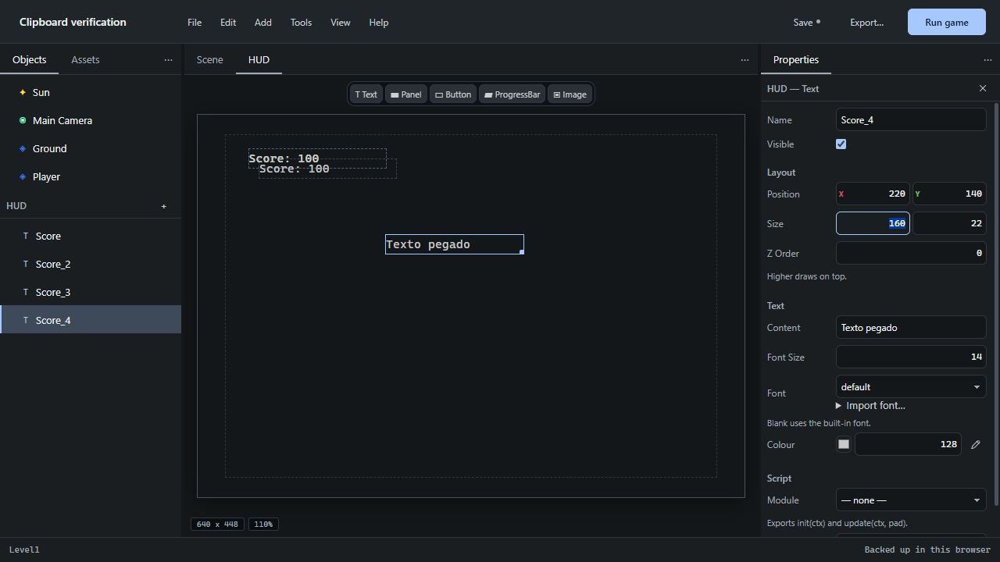
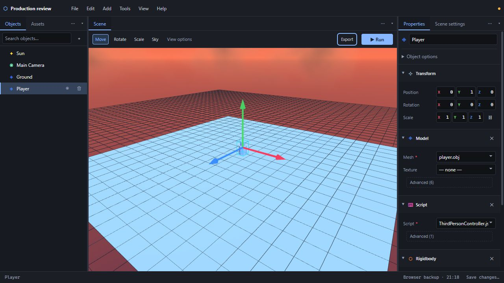
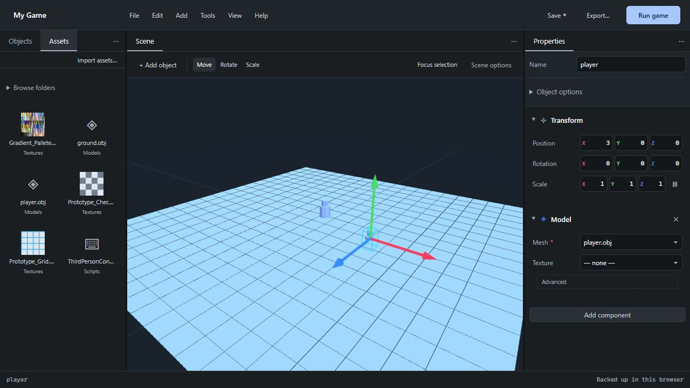
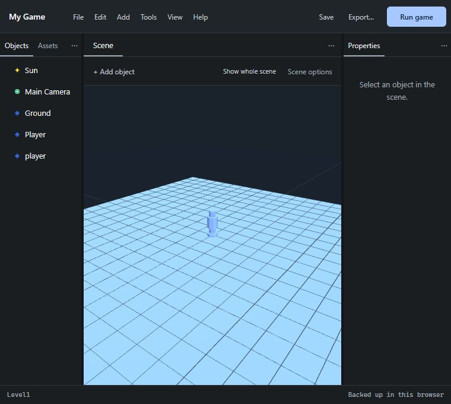
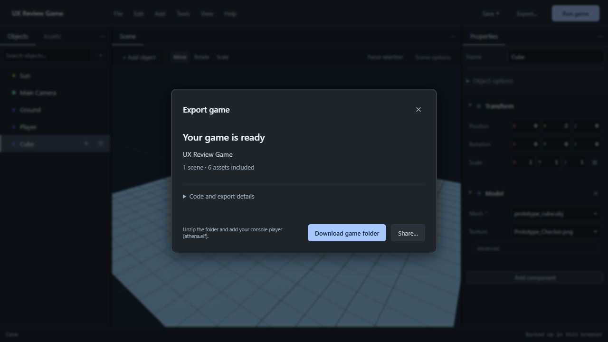

# Production verification — updated 2026-10-11

## October 11 publication check: native backdrop blending

Backdrop drawing now disables PABE, which otherwise restricts blending to pixels
whose source alpha MSB is set. Ordinary alpha blending is already enabled by the
engine. Fractional fog alpha therefore blends normally; the authored PABE and alpha
test reference are restored immediately after the backdrop pass. A regression checks
both authored PABE values and a non-default alpha reference. The four native backdrop
fixtures again completed 60 frames each with matching buffers and texture settings
(`.verification/publish-sky-native.log`). Historical October 10 results below precede
this correction.

The publication build passed `deno task check`: **696 passed, 0 failed**
(`.verification/publish-check.log`). The targeted sky controls suite passed all
18 tests (`.verification/publish-sky-tests.log`).

## Game preview request and lower sky backdrops — final October 10 build

The reported GameViewport exception occurred when an absent request and sequence
both yielded undefined IDs, followed by reading requestId on null. Preview loading
and autoplay now share an explicit pending-request guard. The empty Timeline view,
mode changes, missing IDs, wrong sequences and already-consumed requests are covered.

An upper-only sky previously left downward-facing cameras looking through its missing
half. Repeating its edge stretched cloud columns into streaks. That approach has been
replaced by Solid color, Gradient, Foggy gradient and Mirror. The first three use an
untextured mesh with static vertex colors; fog adds a translucent band up to 60 degrees
above the horizon. Mirror uses reversed vertical UVs and the existing sky images.
No additional texture is uploaded and the panorama's horizon detail is preserved.
The browser backdrop remains in the opaque render queue with custom alpha blending,
before ordinary scene geometry. Color edits replace only the small backdrop geometry,
without reloading the sky images. Native setup initializes color buffers once from
JSON, uses numeric Gouraud, accounts for additive diffuse alpha and restores alpha
test/blend settings after drawing with masked depth writes.

`deno task check`: **695 passed, 0 failed** (`.verification/release-check.log`).
`tools/verify-game-sky.js` reproduces the 55-degree downward camera and completes
60 frames for each of the four backdrops in PCSX2. Readbacks match generated corner
counts and vertex colors, with two 1024×512 CT16 textures and Nearest filtering in
every mode. [Archived native readbacks](verification/game-sky-backdrops.json), with
the execution log in `.verification/game-sky-native.log`. These checks
verify native loading, draw completion and buffer state, not exact pixel equivalence.
Browser checks verified all four modes and 20/40-degree fog heights without errors.
The five [feature demos](media/README.md) are browser recordings, with full decoding
checked after encoding. They do not substitute for native gameplay tests.

Save before reloading an already-open editor; existing exported games need re-export.

## October 10 editor audit and native color-array regression

The current 5,136,929-byte supplied project is a single-scene side-scroller without water/terrain/cinematics. A startup trace isolated a long baked RGB array literal: 108 authored entries compiled to 106 under the bundled native runtime. Emitting JSON.parse for this immutable bake preserves all entries without bypassing the native count guard. The unchanged project reaches frame 1200 with 2,051,072 bytes of VRAM. A separate 36-corner probe verifies every RGB and alpha lane at frame 120. Logs: `.verification/current-crash-fixed.log` and `.verification/current-crash-color-regression.log`; tool: `tools/verify-vertex-colors.js`. No physical-console claim is made.

The same project was used for 40 color-edit preparation trials after five warmups. Median preparation is 29.7694 ms before and 5.2207 ms after immutable branch sharing, saving 24.5487 ms (82.5%). This excludes browser/GPU rendering. Picker inputs additionally coalesce at 50 ms and commit the final color as one undo step.

Final build plus regression suite: **689 passed, 0 failed** (`.verification/editor-audit-check.log`). Browser checks verified final color/one-step undo, inactive Scene canvas disposal, dock carousel limits, Timeline duplicate/delete and live ES/PT/EN language switching, with no recorded console warnings/errors. See [the audit and fifteen additional improvements](EDITOR-AUDIT.md).

## October 10 water performance, original sky detail and editor workflow

The supplied `my_game.atheditor` was profiled without overwriting it. Its terrain has
10,158 triangles and its water has 512. The initial measured water update alone took
295.6 ms/frame. Native wave/UV caches, independent clocks and baked static receiver
caustics remove the repeated per-corner JavaScript and raycasts. Fog updates are
budgeted across frames and reuse settled static results; dense moving views can take
about a second to finish refreshing their fog colors.

The final water experiment retains the supplied terrain/player/physics and sets all
six water quality controls to maximum: 512² texture, animated pattern, panning, mesh
waves, transparency and caustics. Authored wave height is 0.3, flow X/Z is 0.1/0.015,
ripple is 0.05 and wave speed is 0.5. Every variant uses the bundled Athena ELF,
PCSX2, CT16S + Z16S, 60 frames and 10 warmup frames; means cover the final 50 frames.
Each individual comparison disables only the named optimization.

| Configuration | Mean callback | Saved by the optimization |
| --- | ---: | ---: |
| All three optimizations enabled | 10.27690 ms | — |
| Without cached position copies | 14.60798 ms | **4.33108 ms/frame** |
| Without cached UV copies | 22.47374 ms | **12.19684 ms/frame** |
| Without baked static caustics | 13.95760 ms | **3.68070 ms/frame** |
| All three disabled | 30.48628 ms | **20.20938 ms/frame combined** |

The optimized case presents at 16.68336 ms intervals, approximately 59.94 FPS;
all-disabled intervals average 30.39882 ms, approximately 33 FPS. Native VRAM stays
at 3,765,248 bytes and the animation cache is 6,291,456 bytes in every maximum variant.
The sampled position and UV agree between variants. These are emulated EE callback,
physics and drawing-submission timings, excluding GPU completion/presentation, not
measurements on physical PS2 hardware or universal savings for every scene.

Ultra low verified opaque output, one static 32² texture, six mesh corners, no animation
cache and Nearest filtering; its callback averages 2.58138 ms with 59.94 FPS presentation.
A collider-only receiver move invalidated the baked caustics and used the live projector.
Caustics target static floor/platform receivers; moving characters are excluded.
Pose buffers are capped at 8 MB with a fallback, and use 128 temporal phases (64 for
combined wave/ripple/reflection profiles), preserving spatial detail while quantizing
the motion phase. The UI cost range is a calibrated estimate for one visible surface
at 640 × 448; actual coverage, receivers and other scene systems change its cost.

Evidence: `.verification/water-quality-{optimized,positions,uvs,caustics,all-disabled}.json`,
`.verification/water-quality-{moving-receiver,ultra-low}.json` and
`.verification/water-quality-ui.png`. `tools/verify-water-quality.js` reproduces the
native experiment. Independent water/physics and combined fog/reflection/bake probes
also passed. Generic/particle flipbook probes verified one shared 64² T4 atlas, separate
particle ages, frame changes and stable 1,789,184-byte native VRAM.

The ten former stylized single_image skies have been restored byte-for-byte at
1774 × 887. Higher-resolution reconstruction is deferred at the user's request.
Heavy replacements are outside the shipped library. Source data decreased from
29,569,536 to 9,817,778 bytes. Tests compare each packed source to its original at
RGB555 precision and verify conversion directly from it. Outputs exceeding that
resolution warn that they add no detail. Converting settings retires only generated
tiles no longer referenced elsewhere; shared, edited and scripted files remain.
Dimensions and hashes are recorded in `assets/skyboxes/sources.json`.

World, Lighting, Events and Project are independent panels again, along with separate
Assets/Prefabs/UV; no nested panel tabs remain. Focus keeps the default workspace
compact. The Scene/Game **+** opens every panel. World replaces Scene settings;
active camera, gamepad orbit and fallback camera settings live in Game. All advanced
disclosures now use the ordinary triangle and a stable label. Controls offers saved
hotkeys and exact mouse gestures, presets, sensitivity, smoothing, wheel inversion
and selection drag threshold. Duplicate bindings are rejected. Tests prove a drag
cannot change selection even after returning to its initial point, while short clicks
commit on release. Timeline clip fields appear in Properties, grouped by purpose.
Terrain omits preview fog and describes the generated indexed atlas cost. Static
contact shading uses an acceleration structure and Draft/Balanced/High samples;
the supplied project baked in 610.93/680.97/693.68 ms in the browser measurement.
New Sun ambient is neutral and baked directional lighting is opt-in. Authored colors
remain unchanged. View's UI animations toggle defaults off and enables short feedback
for click/change/keyboard actions, including detached panels.

The full build and regression suite passed **674 tests, 0 failures**. After correcting
the Game camera dialog's behavior in narrow panels, the 25 inspector/input/workspace
checks passed again. Restored Tropical blue and Aurora both reached frame 40 in the
bundled ELF through PCSX2, with one 1024 × 512 T8 texture and Linear filtering
(`.verification/skyboxes-originals.json`). Browser checks verified saved mouse presets,
drag threshold and remapped hotkeys, rejected duplicate bindings, and confirmed that
orbiting preserves selection while a click selects. The **+** opened Lighting, Events
and Project as independent panels. Camera settings remained fully visible in a narrow
Game panel and opened the actual camera in Properties. No browser console errors or
warnings were recorded. Screenshots: `.verification/restored-skies-library-ui.png`,
`.verification/restored-single-image-ui.png`, `.verification/editor-controls-ui.png`,
`.verification/editor-hotkey-ui.png` and `.verification/game-camera-settings-ui.png`.

Large texture/mesh payloads are compressed losslessly in a background worker for
browser recovery; unchanged values reuse a bounded cache. Portable files/native
assets keep original data. Corrupt compressed payloads recover the prior slot.
The coastal scene-reload hang remains reproducible in the bundled runtime, including
a baseline without the new effects. Single-scene execution passes; this is not a
claim of general reload safety.

## Coastal scene tools — October 9

Added animated water/caustics, rounded terrain and baked texture blending, pooled
bubbles/splash/fountains, fake environment reflections, distance fog, mass vertex
coloring and shared directional silhouette baking. Static OBJ vertex shading uses
recess/contact, midtone and highlight colors with independent strengths and optional
ambient/directional lighting. Matching shadow geometry/profiles share indexed images
even when vertex-color bakes use different model filenames. See [setup and costs](COASTAL-SCENES.md).

Native fixtures executed through the bundled ELF in PCSX2:

- `tools/verify-water.js`: 40 frames both with and without physics; UV flow and wave
  heights changed, effective opacity remained 0.4, caustic projection completed.
  Final measured VRAM was 1,803,776 bytes in each case.
- `tools/verify-particles.js`: timer-triggered splash reached 12 independent active
  sprites at 0.25 seconds and stopped after its lifetime. One emitter RenderObject,
  fixed 64-quad capacity and a selected draw range; source placement remained intact.
  A timer-triggered Timeline clip played the fountain without additional model pools,
  then restored its stopped state. Homogeneous position W remained one.
  The 90-frame probe reported 1,791,488 bytes without growth.
- `tools/verify-environment.js --single --effects`: combined terrain atlas, water,
  caustics, shared blobs, vertex colors, fog and water reflections reached frame 30.
  Native fog alpha and reflection texture assignment were read back; measured VRAM
  was 1,853,696 bytes. Fog adds no texture, while the reflection map costs 8,448 bytes.
- `tools/verify-shadow-receivers.js`: floor Y=0, platform Y=21, moved platform Y=31,
  and removal after destruction passed through frame 95. Soft blobs use alpha-test
  reference zero and masked depth writes; caster colliders remain excluded.

Readbacks are `.verification/water.json`, `.verification/particles.json`,
`.verification/environment.json` and `.verification/shadow-receivers.json`.
These are execution/state assertions, not pixel equivalence or real-hardware certification.
The coastal project used by the combined fixture is `.verification/coastal-tools.athena.json`.

Browser review covered Add Water/particle presets, movement above the water, Scene/Game
preview, visible Environment fog/reflection/color controls, applying/restoring static
vertex colors, water reflection assignment, and an emitter clip preview/scrub at 0.60 s
without legacy instance controls. Current browser console checks report
no errors. Screenshots are stored in `.verification/coastal-editor.png` and
`.verification/coastal-environment.png`; Game playback is `.verification/coastal-game.png`.
Automated final results are recorded in
`.verification/coastal-check.log`: **645 passed, 0 failed** after the final build.

**Remaining native limitation:** the combined coastal scene hangs during scene reload.
Its plain-model baseline also hangs with water animation, shadows, physics and vertex
colors disabled. The single-scene fixture passes; reload is explicitly unverified/failed
and is not counted as passing. The bundled ELF is unchanged. Browser Game approximates
materials and does not run exported behavior scripts or ODE. Native fog currently covers
static OBJ surfaces; geometry overlays cost RAM and an extra draw per object.

## Sky texture controls and VRAM — October 9

Sky exposes discrete sliders for 4/8/16-bit storage and 128/256/512/1024-pixel
sectors, an upper-hemisphere toggle and LINEAR/NEAREST filtering. First selection
prefers 4 bits, 1024-pixel sectors and upper sky; existing scenes retain their
settings. Two sectors permit a 2048 × 1024 full panorama while each uploaded
image stays inside the GS's 1024-pixel limit. Built-in sources retain CT16 color;
the 4/8-bit variants share one palette across both sectors. Imported original
panoramas remain available for subsequent resizing and color conversion.

Problems estimates two color buffers, the depth buffer, referenced textures,
palettes and locked shadow targets, using native GS block alignment.
CT24/Z24 occupy 32-bit storage. Total pressure warns about streaming; an image
that cannot fit alongside locked surfaces is an error. A 16-bit framebuffer fix
is offered when applicable. Fonts, model-embedded images and unknown external
image payloads are outside this estimate. Buffer dimensions are estimated from
NTSC/PAL boot defaults because export inherits Screen.getMode().

Six native fixtures completed 40 frames, checking actual image dimensions,
depth and filtering: legacy tropical/aurora, maximum-size T4 upper sky, T8 full
sky, CT16 upper aurora and maximum-size T4 full sky with CT32/Z24 streaming.
Browser checks verified sliders, hemisphere, filtering, the Problems warning,
and its corrective action. Evidence: `.verification/skyboxes.json` and
`.verification/sky-controls-vram.png`. Automated results are in
`.verification/sky-controls-check.log`: **623 passed, 0 failed**.

## Vivid sky library — October 9

All ten built-in skies were replaced by authored full-sphere panoramas. The embedded
images are opaque indexed 1024×512 PNGs (T8, 512 KB + 1 KB CLUT), with equal seam
texels and convergent poles verified for every preset. Untouched old built-ins migrate
in place; custom and edited assets keep their pixels. Source PNGs and generation
briefs live in `assets/skyboxes`; `tools/generate-skyboxes.js` rebuilds offline.

`deno task check`: **614 passed, 0 failed**. `tools/verify-skyboxes.js` rendered
tropical and aurora presets at horizontal FOV 100° through the bundled AthenaEnv
runtime in PCSX2, each reaching frame 40. This verifies native loading/drawing,
not pixel equivalence or physical hardware. Browser checks verified preset
selection, the visible Scene angle selector, updating the active Game camera
to 100°, and Undo restoring its previous 60° setting. Scene defaults to 100°;
pre-existing Game cameras are changed only through the explicit button.

Evidence: `.verification/check-skyboxes.log`, `.verification/skyboxes.json`,
`.verification/skybox-tropical.png`, `.verification/skybox-aurora.png`.

## Version 1.5 authoring and shadow receivers — October 9

The source passes **614 automated tests**. The authoring additions are visual
event conditions/action chains, timeline keyframes/curves/fades/camera transitions
and skeletal blending, reusable sequences, prefab variants, and asset thumbnails,
type/folder management, broken-reference diagnostics and safe reimport/deletion.
Browser checks covered visual event editing, asset reimport, prefab variant
creation, stacked animation clips and Game playback/scrubbing without console
errors. Preview uses an isolated scene and does not change the authored project.

Native fixtures passed event filtering → cinematic suspension → door/collider
movement → enemy activation → a delayed scene exit; keyframes/fades/camera
restoration; and overlapping skeletal pose/quaternion blending with restoration.
Reproduce with `tools/verify-event-flows.js`, `tools/verify-timeline-authoring.js`
and `tools/verify-animation-mixing.js`, each using `deno run -A`.

New shadows drape by default, with the control visible outside Advanced. Receiver
queries use separate ODE spaces, omit the caster actor and triggers, share
identical receiver sets, follow moving colliders and remove destroyed receivers.
`tools/verify-shadow-receivers.js` passes native centre-ray checks at Y=0, on a
platform at Y=21, after moving it to Y=31, and after destroying it. The emitted
ray starts at the moving caster, so the old fixed-height limit is eliminated.
This validates native geometry queries and projector execution, not pixel output.

**Remaining engine limitation:** live render-target shadows can hang on native
scene reload. The same failure occurs with the previous flat-shadow path.
The optional shadow `--reload` probe currently fails; it is not included among
the passing native transition fixtures. The bundled ELF has not been patched.
Evidence and browser screenshots remain in the local `.verification/` directory.

## Events, timeline, Game and editor UI — October 8

The updated source passes **586 automated tests**. The browser review verified
the project/scene dropdown, immediate scene creation and switching, **+ → Terrain**,
the Focus layout's Scene/Game tabs, selection of a second active camera, and
timeline playback/scrubbing with dialogue visible in Game. The editor uses navy
surfaces, blue selected tabs, shared SVG icons and component cards.

Native fixtures were run with the bundled AthenaEnv ELF in PCSX2. Physics reported
collision and overlap enter/exit events. Destroy Object and Change Scene presets
passed. Cinematic fixtures passed scene-start/custom/timer/before-exit playback,
gameplay suspension, property restoration and destination loading. The media
fixture played a real WAV and skinned glTF animation, restored its default
animation, used a nested active camera, and then ran collision audio/animation
presets. These exposed and fixed the release's global-stream rewind ordering bug.
Only unmodified copies of the old Sound Oneshot preset are upgraded automatically.

Reproduce these checks with `deno task check`, `tools/verify-physics-events.js`,
`tools/verify-event-presets.js`, `tools/verify-cinematics.js` and
`tools/verify-cinematic-media.js` (each fixture uses `deno run -A`). Records and
browser screenshots are in the local `.verification/` directory. See
[Cinematics](CINEMATICS.md) for audio/font limits and the distinction between
browser preview and native Play.

The standalone editor is built from the current source; index.html is synchronized
with that build. The current UX review used Deno 2.9.2 and a Chromium browser, including
Run/Stop through the local PCSX2 launcher. The baseline was bdb36e2; the existing
playable-start and focused-workspace redesign was reviewed and extended.
The earlier scene-transition fixtures below were recorded on October 1 with PCSX2 2.6.3.
The template benchmarks and controller fixtures were rerun on October 2 with the
official August 1 AthenaEnv release, as described below.

## Template optimizations — October 2

All five templates were measured before/after against af1d0c0 with identical runtime,
PCSX2 2.6.3, Vulkan, NTSC and CT16S/Z16S. Thirty independent launches each completed
120 warmup and 600 measured frames. Median callback-time reductions are **15.4% Empty,
75.4% First Person, 14.4% Third Person, 37.9% Side Scroller and 20.6% Top Down**.
The callback measures emulated EE logic, physics and drawing submission, excluding
presentation and GPU completion. VRAM remains 1,786,880 bytes; both versions maintain
approximately 59.94 FPS with VSync. See the [complete method and tradeoffs](TEMPLATE-PERFORMANCE.md)
and [all 30 numeric records](verification/template-performance.json).

Native generated movement/camera fixtures passed for all four playable templates;
their [records](verification/templates.json) cover settled bodies and right/forward movement.
Additional [controller quality probes](verification/controller-quality.json) verify
bounded diagonal speed, camera clamps, shortest turns through ±π, buffered landing
and edge jumps, rejection of repeated rising jumps and real ceiling contacts.
The Side Scroller [1,030-frame momentum sequence](verification/momentum-optimized.json)
passes all assertions for progressive sprint, coasting, skidding, rolling, charge/launch,
variable jump, ground pound/recovery, one air dash and platform jumping.

The ten new regression tests also cover moving static collider bounds, unknown-shape
fallback, settled transform/trigonometry reuse, overlay disablement, unchanged 50-triangle
smooth normals and exact agreement between downloadable and embedded controllers.
The complete build and suite pass **549 tests, zero failures**. These checks use PCSX2;
real PS2 hardware was not tested. Existing projects keep their authored controller copies.

## Clipboard and rendering corrections — October 2

The bundled player was updated to the official August 1 `latest` release; the
downloaded archive matched GitHub's SHA-256 digest. The extracted ELF hash and
release commit are recorded in [the runtime reference](../reference/AthenaEnvReleaseAndExamples/README.md).
Run uses that ELF unless a custom runtime has been selected.

- Ctrl+V invokes the clipboard reader during the keyboard gesture, with a fallback
  to the editor's last copy when access is denied. Native paste cancels a pending
  read to prevent duplicate imports. A delayed read cannot paste into another scene.
- All five HUD element types support Copy, Paste and Duplicate, independent values,
  unique IDs/names/script context keys, referenced image/font/script assets and one-step undo.
  Native Copy/Paste also works in detached panels; inputs retain normal text editing.
- NEAREST is assigned after all RenderData constructors, which otherwise reset shared
  Images to LINEAR. Embedded images are all updated. Terrain preview reacts to filter,
  shading, pipeline and texture-mapping changes without requiring another paint stroke.
- Gouraud and Flat emit numeric GS IIP values 1 and 0. The released Render module does
  not expose the SHADE constants previously used; undefined was silently interpreted as Flat.
  The silhouette pass restores this numeric choice after every shadow render.
- The sky masks writes to the main depth buffer, uses DEPTH_ALWAYS, then restores
  normal writes before geometry. Sky and live shadows share one buffer initialization.
  CT16S + Z16S remains available with its original VRAM footprint.

The eight supplied PCSX2 dumps had the same access violation at GSRendererHW::Draw
while resizing a target (official 2.6.3 symbols, GSRendererHW.cpp:4387). A private copy
of the staged game corresponding to a dump reproduced the crash with both the old and
latest Athena ELF. Disabling the sky avoided it; masking its depth writes fixed it.
Raw dumps and the user's staged game remain private and are not included in the repository.

Final PCSX2 2.6.3 hardware-renderer checks each reached **600 frames** and remained
running until the test stopped its own process:

| Execution | Color / depth | Result |
| --- | --- | --- |
| Copy of the supplied failing scene, corrected sky pass | CT16S / Z16S | Passed |
| Fresh side-scroller with desert sky, current generator | CT16S / Z16S | Passed |
| Sphere, terrain, desert sky and live shadow, current generator | CT16S / Z16S | Passed |
| Same combined scene, control format | CT32 / Z32 | Passed |

Runtime probes also confirmed sphere/terrain Image.filter = 0 (NEAREST), Gouraud = 1
and Flat = 0. A further two-caster live-shadow check confirmed those values persist
at frame 600 in both CT16S/Z16S and CT32/Z32. Earlier comparison probes reproduced Flat = 0 for both old SHADE constant
assignments. These are emulator checks; real PS2 hardware was not tested.
The [numeric readbacks](verification/render-settings.json) retain the modes,
frame counts, filters and shading values without the private project or dumps.

Browser checks verified HUD menu Copy, Ctrl+D, consecutive Ctrl+V without extra copies,
and Ctrl+V within a text property without creating HUD elements. No console warnings/errors.
The actual keyboard and native Copy handlers are also exercised in the regression suite.

## Changes verified

- A third-person game is the initial project; alternate starting points are optional.
  Name/Enter, busy state and cancellation preserve a predictable creation flow.
- New projects enter Focus even after a customized layout. Selection reveals Properties;
  object/HUD creation uses a scoped picker, with seven common objects shown first.
- Save and Export remain available across tools; Run is primary in the local installation,
  while Export is primary on the hosted site and standalone file. Scene transforms require a selection;
  scene options and less common properties appear when requested or needed for an error.
- Property search follows the selection, mixed values are explicit, and changing one axis
  in a multi-selection preserves each object's other axes. Panel tabs support keyboard navigation.
- Export shows readiness and contents before code details. Copy appears with the code;
  Save and continue preserves the pending replacement if saving is cancelled or fails.
- First-run welcome and Focus workspace; contextual properties and advanced controls.
- Portable Save includes imported binaries and scripts. Disk backups yield to refreshed
  files; deliberate editor working copies retain precedence.
- New project cancellation preserves unsaved objects and undo history. All project
  replacement paths use the existing protection.
- Export boots the start scene and includes every executable level in ZIP, linked-folder
  writes and Run staging. Run can start the open scene independently.
- Named scene exits queue their destination and reload at the next frame boundary.
  Generated modules finish evaluating before the engine destroys their interpreter.
- Missing assets/scripts, invalid exits, ambiguous basenames, unsafe filenames and external
  glTF dependencies are actionable errors that prevent a misleading successful export.
- Unattached helper scripts are bundled with the game, including modules needed by behaviours.
- Namespace imports support behaviours defining init, update or both.
- Export diagnostics identify the scene and can reveal an object/HUD element in another level.
- Keyboard-operable menus and sections, named input axes, dialog focus restoration and
  reduced-motion support.
- Build replacement is atomic. Test staging refuses to replace directories it does not own.
- CI rebuilds and tests before Pages deployment; its public artifact contains only the editor.
- Assets starts with all files, including subfolders; folder filtering is optional and
  search spans the library. Selecting a file retains a relevant filter.
- Add a model chooses a real asset or imports and places one in one undo step. Cancellation,
  invalid OBJ input, retry and an import finishing in another project/scene are handled.
- Models can be dragged to visible scene surfaces, with ground fallback, base compensation
  and the current snapping setting. Undo removes the placement and its transformation tools.
- Menus close outside their task; Escape restores focus. Keyboard navigation and dialog
  focus exclude controls inside closed disclosures, even when the browser reports their rectangles.
- Small object/asset lists omit search. Duplicate empty-state actions and hidden-button
  space were removed. Narrow panels retain readable object names and tab labels.
- Download fallback status distinguishes the request from an actual saved file. Web Run
  opens useful local-installation guidance with a direct Export action.

## Automated suite

`deno task check`: **549 passed, 0 failed**. The suite covers project migration,
generation, hierarchy, physics/shadow math, viewport geometry/resources, fonts, terrain,
prefabs, assets, history, folder operations, project replacement, saves, launcher isolation
and exported bundles. The added UX tests cover creation, dialog focus, cancellation,
scoped object/HUD choices, contextual actions, selection and shared properties. New
regressions cover library navigation, import/placement history, scene drop positions,
transient popovers, web Run and download status. Editor
callback tests execute the actual command handlers; they do not emulate React effects
or native picker dialogs.

## Browser checks

Verified first run and name/Enter creation; existing playable-start and Focus layout;
model chooser cancellation, invalid OBJ import followed by a successful retry, immediate
selection/properties and one-step undo; dragging an existing model onto the ground and
undoing it; numeric editing; Scene options; File-menu arrows/Home/End and Escape focus
restoration; local Run/Stop; export readiness with details collapsed. The service-free
version was checked separately: Export is primary, F5 opens Run on your computer and its
Export action reaches a ready export. No local-launch request or configuration form appears.

The workspace was checked at 1280×720, 1024×768 and 760×680. A final CSS pass removed
hidden-button space and confirmed readable object names/tabs in the narrow view. Final
local and service-free sessions: **0 warnings/errors**. The full suite passed before
this last CSS-only pass; the final standalone build was rebuilt afterwards.

Browser backup recovery and the other production behaviours above also retain their
October 1 evidence and automated coverage. Earlier October 2 checks also covered
replacement cancellation, active-camera editing and Sky beside the scene. Workspace,
library, responsive and export screenshots below show this final build; sky.jpg records
the earlier October 2 review of the unchanged sky interface.

The embedded browser did not expose the export download event. The ZIP's actual byte
structure, scene entries and payloads are covered separately by automated tests. Native
file/folder dialogs were not automated; the logic after picker selection and cancelled
saves is covered by tests.

## Actual console-player execution

The following October 1 fixtures remain relevant because this redesign did not change
the generated game loop, controller templates or console engine.

`deno run -A tools/verify-templates.js` launched each generated game through the same
isolated launcher as Run. All **four controller templates passed** settling/gravity,
camera position and right/forward input assertions. Side Scroller also kept depth fixed.
The full numeric readbacks are in [templates.json](verification/templates.json).

`deno run -A tools/verify-levels.js` recorded **ten alternating level entries**,
First → Second → First → Second, with no captured startup error. This is an execution
test of the shipped player, not only a string comparison of generated code.
Readbacks are in [levels.json](verification/levels.json).

The old top-level infinite loop hung during reload because its module was still evaluating.
Screen.display now registers a frame callback after evaluation; the engine performs the
clear and presentation itself. There is no second Screen.flip in the generated callback.

## Scope and remaining limits

Real PS2 hardware was not available for this review. The browser preview is a scene editor,
not a PS2 renderer; emulator checks do not certify every combination of models, textures,
sound, animation or arbitrary user scripts. Assets are identified by filename in their
category; nested external model dependency layouts are not preserved. Use self-contained
GLB and flat script/module filenames for portable exports.

Browser recovery copies and linked-folder permissions belong to their origin/profile.
Imported folder bytes become portable when saved to a file; a recovery copy alone should
not be treated as a complete backup of external files. Specialized future work in ROADMAP
is historical planning, not a claim that every proposed capability ships in this release.

See the [nine-section design review and all 24 guide steps](UX-REVIEW.md).
The deployment uses the documented [GitHub Pages action](https://github.com/actions/deploy-pages)
and [Deno setup workflow](https://docs.deno.com/examples/deno_github_actions_tutorial/).
