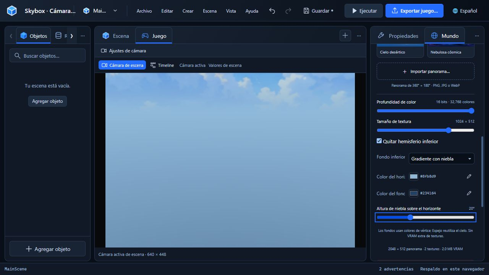

# Cinco demos del editor

Capturas de la interfaz real de AthEditor, realizadas el 10 de octubre de 2026. Cada feature tiene su propio MP4 H.264, sin audio.

| Feature | Video | Qué muestra |
| --- | --- | --- |
| Cinemáticas | [01-cinematicas.mp4](01-cinematicas.mp4) | Timeline, edición de diálogo, movimiento de clip y reproducción de cámara/diálogo en Game. |
| Eventos | [02-eventos.mp4](02-eventos.mp4) | Timer, condición por objeto, acciones encadenadas y preset Play Cinematic en Rigidbody. |
| Calidad del agua | [03-agua.mp4](03-agua.mp4) | Máximo → Ultra low → máximo; efectos, filtrado y costo estimado. |
| Terreno | [04-terreno.mp4](04-terreno.mp4) | Elevación con pincel, pintura de piedra y mezcla de texturas. |
| Controles y entornos | [05-editor.mp4](05-editor.mp4) | Botón +, bindings, selección por arrastre, escenas, idioma, layouts y los cuatro fondos del hemisferio inferior. |

Las pausas sobre controles son intencionales para poder leerlos. El movimiento de agua y cinemáticas conserva el tiempo transcurrido durante la captura; los frames se ensamblaron a 24 fps. Se agregan márgenes al cambiar el tamaño de la ventana, sin recortar controles.

Estas demos verifican la autoría y el preview del navegador. El video de eventos muestra su configuración; su ejecución en el juego se verifica con los probes nativos documentados en [Production verification](../PRODUCTION-VERIFICATION.md). Game no ejecuta scripts arbitrarios de gameplay ni ODE. La cifra de costo del agua es una estimación, no un benchmark del video.

